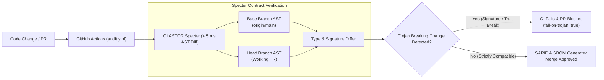

# SemVer Stability & API Contract Guarantees with GLASTOR Specter

> **Enterprise Stability Guarantee:** How `pii-veil` eliminates unexpected breakage, guarantees semantic versioning (SemVer), and enforces zero Trojan Breaking Changes across all public C-ABI, Rust, Python, Node.js, and Go SDK boundaries using **GLASTOR Specter**.

---

## 1. The Enterprise Problem: Trojan Breaking Changes

In mission-critical production pipelines (fintech, banking, healthcare, AI gateways), a major barrier to adopting open-source infrastructure is **dependency risk**:
- A dependency releases a patch version (e.g. `v0.1.3` to `v0.1.4`) that unexpectedly alters a method signature, changes return types, or modifies an enum variant.
- These silent breaking changes (known as **Trojan Breaking Changes**) cause compilation failures, runtime crashes, or silent data corruption in downstream services.

To protect enterprise adopters, **`pii-veil` treats API contracts as cryptographic commitments**.

---

## 2. The GLASTOR Specter Architecture

Every pull request, commit, and release in `pii-veil` is continuously monitored by **GLASTOR Specter** (`glastor-core/specter`), an AST-level API contract differential auditor.



### What Specter Audits in < 5 ms:
1. **Public Function Signatures:** Argument counts, argument types, return types, and generic bounds.
2. **Struct & Field Visibility:** Field addition, removal, or visibility scope changes on public structs.
3. **Enum Variants:** Variant changes, payload alterations, or missing exhaustive handling.
4. **Trait Definitions & Implementations:** Added methods without default implementations or altered trait bounds.
5. **C-ABI Export Boundary:** `crates/veil-ffi` function pointers and symbols exposed via `pii_veil.h`.

---

## 3. Our SemVer Policy & Stability Commitment

`pii-veil` strictly enforces the following semantic versioning guarantees across all distribution channels:

| Version Jump | Breaking Changes Allowed? | Audit Rule in Specter | Typical Content |
| :--- | :---: | :--- | :--- |
| **Patch (`0.1.x` -> `0.1.y`)** | **NEVER** | `fail-on-trojan: "true"` | Bug fixes, internal performance optimizations, new checksum validators. |
| **Minor (`0.1.0` -> `0.2.0`)** | **NO (Without Deprecation)** | Audited & Documented | Backward-compatible feature additions, new detector kinds. |
| **Major (`1.0.0` -> `2.0.0`)** | **YES (With Migration Guide)** | Full Architectural Review | Major redesigns with multi-version deprecation periods. |

### Deprecation Protocol
Before any public API method is removed or altered:
1. The method is marked with `#[deprecated(since = "x.y.z", note = "...")]`.
2. A drop-in replacement is documented in `CHANGELOG.md`.
3. The deprecated method remains functional for at least **two subsequent minor releases** before removal.

---

## 4. Continuous Integration & Auditing Pipeline

Specter is enforced as a required check in [`.github/workflows/audit.yml`](../.github/workflows/audit.yml):

```yaml
specter-semver-audit:
  name: Specter — API Contract & SemVer Audit
  runs-on: ubuntu-latest
  steps:
    - uses: actions/checkout@v7
      with:
        fetch-depth: 0
    - name: Run GLASTOR Specter API Contract Verification
      uses: glastor-core/specter@v1
      with:
        base-ref: "origin/main"
        fail-on-trojan: "true"
        output-sarif: "specter.sarif"
        output-sbom: "specter-sbom.cdx.json"
        post-pr-comment: "true"
```

If any commit introduces a breaking change without an intentional, authorized SemVer bump, the CI run immediately fails and blocks the pull request from merging.

---

## 5. Fuzzing & Behavioral Stability (cargo-fuzz & Fuzz Smoke)

API contract stability is paired with **rigorous fuzz testing**:
- **Continuous Fuzz Smoke Suite:** Multi-thousand iteration randomized fuzz test ([`crates/veil-core/tests/fuzz_smoke.rs`](../crates/veil-core/tests/fuzz_smoke.rs)) runs on every CI build across Windows, macOS, and Linux, verifying zero panics on malformed UTF-8, split placeholder boundaries, and chaotic token feeds.
- **LibFuzzer Harness (`fuzz/`):** Dedicated libFuzzer targets for continuous fuzzing:
  - `fuzz_redact`: Fuzzes arbitrary inputs across Placeholder, Synthetic, and Mask modes.
  - `fuzz_restore`: Fuzzes single-pass and stateful chunked restoration.
  - `fuzz_checksums`: Fuzzes Luhn, Mod-97, Mod-11, Mod-23, and IPv4 validators.

To run the libFuzzer suite locally:
```bash
cargo install cargo-fuzz
cargo fuzz run fuzz_redact
cargo fuzz run fuzz_restore
cargo fuzz run fuzz_checksums
```

---

## 6. Enterprise Takeaway

Adopting `pii-veil` guarantees:
1. **Zero Unexpected Breakage:** Specter mathematically guarantees that updating `pii-veil` will never break your build or runtime bindings.
2. **Audit-Ready Telemetry:** Every release generates machine-readable **SARIF 2.1.0** and **CycloneDX 1.5 SBOM** reports for enterprise DevSecOps pipelines.
3. **High Fuzz Coverage:** Deterministic safety across all parsing and token reconstitution logic.

---

© 2026 GLASTOR Core Organization — Security & Infrastructure Team.
